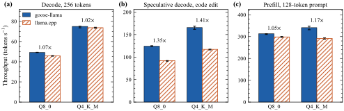
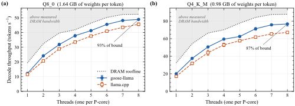
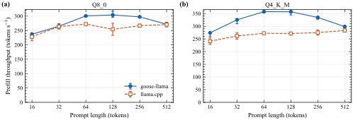

# goose-llama

llama.cpp's CPU inference path for GGUF models (qwen2, llama), rewritten in [Goose](https://github.com/aardappel/goose).

Support: [GoFundMe](https://gofund.me/af0569852)

## Results

i9-13900KF, DDR5-6000, Windows 11, Qwen2.5-1.5B-Instruct, CPU only, llama.cpp b10566. Median of 3 runs; data in `results/results.json`.

| tokens/s | goose-llama | llama.cpp |
|---|---|---|
| Q8_0 decode | 49.1 | 45.8 |
| Q8_0 speculative | 124.2 | 92.1 |
| Q8_0 prefill, 128 tokens | 313.1 | 298.5 |
| Q4_K_M decode | 75.0 | 73.7 |
| Q4_K_M speculative | 165.6 | 117.1 |
| Q4_K_M prefill, 128 tokens | 341.1 | 291.5 |

- **Decode:** 256 tokens, no drafting, vs `llama-bench` tg128.
- **Speculative:** `test/p_code.txt` with n-gram drafts, vs `llama-lookup`.
- **Prefill:** vs `llama-bench` pp128.

Perplexity, `test/ppl.txt` with `-c 128` (goose-llama vs llama.cpp): Q8_0 10.41 vs 10.43; Q4_K_M 10.77 vs 10.86.





## Build

```
git clone https://github.com/aardappel/goose ..\goose
cd ..\goose && git checkout 74c641c && git apply ..\goose-llama\goose\goose-llama.patch && cd ..\goose-llama
tools\build_goose.bat
..\goose\build\goose.exe build llama.goose --cc clang -o llama.exe
tools\pinhi.bat FFFF llama.exe -m model.gguf -p "Hello" -n 64
```

Reproduce: `python test/compare.py && python test/figs.py`

## License

`goose/goose-llama.patch` and `test/ppl*.txt` (from Goose's docs) are Apache-2.0; see `goose/LICENSE`.
